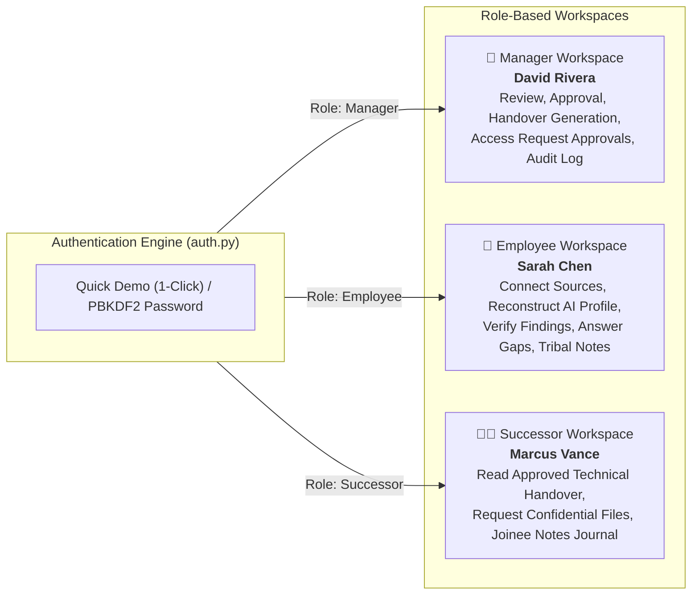
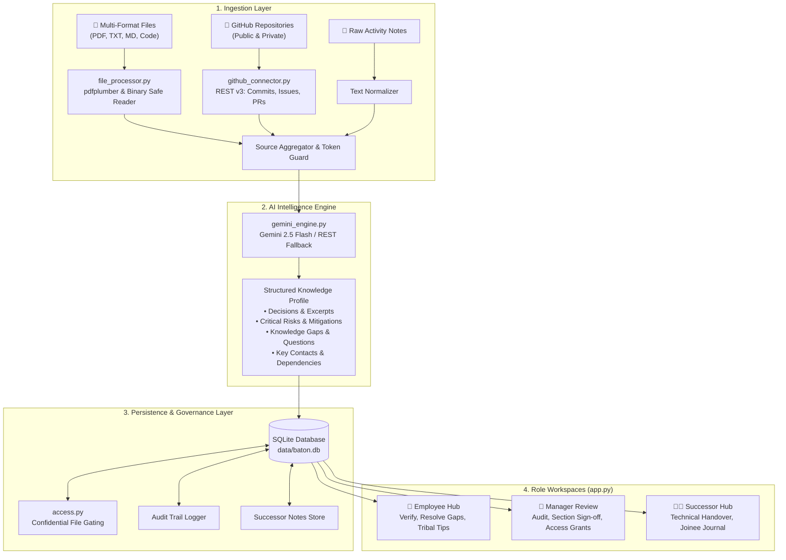

# 🏃‍♂️ Baton — Comprehensive Project Report & System Architecture
### Intelligent Knowledge Handover & Institutional Memory Preservation Platform
**Hackathon Track:** Prevent Critical Knowledge From Leaving With People  
**Project Name:** Baton | **Submitted By:** Vaibhav Pawar (Codepunethinkers)  
**Project Version:** v2.5 (Enterprise RBAC, Persistent SQLite, Joinee Journal & Luxury Palette)  
**Date:** November 2026  

---

## Table of Contents
1. [Executive Summary & Vision](#1-executive-summary--vision)
2. [Problem Statement & Enterprise Context](#2-problem-statement--enterprise-context)
3. [Multi-Role RBAC & User Personas](#3-multi-role-rbac--user-personas)
   - 3.1 Role-Based Access Control Architecture
   - 3.2 One-Click Instant Demo Authentication
   - 3.3 Persona Deep-Dives (Departing Employee, Manager, Successor)
4. [End-to-End System Architecture](#4-end-to-end-system-architecture)
   - 4.1 System Topology & Data Flow
   - 4.2 The 5-Step Human-in-the-Loop Pipeline
5. [In-Depth Codebase Walkthrough & Module Breakdown](#5-in-depth-codebase-walkthrough--module-breakdown)
   - 5.1 `app.py` — Multi-Role Controller & Responsive UI Shell
   - 5.2 `utils/auth.py` — Cryptographic Authentication & Single-Click Access
   - 5.3 `utils/access.py` — Permission Governance & Confidential File Gating
   - 5.4 `utils/store.py` — Enterprise SQLite Relational Engine
   - 5.5 `utils/demo_seed.py` — Harborline Incident Dataset & Auto-Seeding
   - 5.6 `utils/file_processor.py` — Multi-Format Binary & Document Parser
   - 5.7 `utils/gemini_engine.py` — Generative Extraction & Multi-Perspective Synthesis
   - 5.8 `utils/github_connector.py` — GitHub REST v3 Codebase Ingestion
   - 5.9 Configuration & Theme Tokens (`.streamlit/config.toml`)
6. [UI/UX Design System: The Luxury Skincare Palette](#6-uiux-design-system-the-luxury-skincare-palette)
   - 6.1 The 3-Color Master Palette
   - 6.2 The Cardinal Rule: Zero Text on Brown
   - 6.3 Complete Design Token Specification
   - 6.4 Dual-Mode Architecture & Theme Toggle Preservation
7. [Enterprise Security, Trust & Audit Governance](#7-enterprise-security-trust--audit-governance)
   - 7.1 Confidential File Protection & Request/Approval Workflow
   - 7.2 Immutable Audit Trail & Activity Logging
   - 7.3 Traceable Citations Over Hallucination
8. [Successor Experience & Joinee Transition Journal](#8-successor-experience--joinee-transition-journal)
   - 8.1 Technical Handover Package Consumption
   - 8.2 Interactive Joinee Notes & Transition Diary
   - 8.3 Confidential Document Previewer
9. [Setup, Execution & Evaluation Guide](#9-setup-execution--evaluation-guide)
   - 9.1 Local Development Quickstart
   - 9.2 Running Single-Click Demo Evaluation
   - 9.3 Production & Cloud Deployment
10. [Planned vs. Delivered Roadmap & Future Horizons](#10-planned-vs-delivered-roadmap--future-horizons)

---

## 1. Executive Summary & Vision

Every time a skilled engineer, architect, or engineering manager departs an organization, years of undocumented decisions, tribal processes, edge-case workarounds, and vendor context walk out the door with them. This "knowledge leakage" costs global enterprises an estimated **$47 billion annually** and leaves replacement hires operating in fear of breaking brittle, unexplained systems.

**Baton** is an enterprise-grade institutional knowledge preservation and handover platform. Instead of relying on a frantic, unstructured two-week documentation scramble during a notice period, Baton connects to the tools where engineering actually occurs—git repositories, architecture specifications, post-incident reviews, shift handovers, and communications—reconstructs the implicit decision log, surfaces critical risks, and provides an auditable, **human-in-the-loop handover pipeline**.

```
┌────────────────────────────────────────────────────────────────────────────────────────┐
│                                 THE BATON WORKFLOW                                    │
│                                                                                        │
│   [1. Connect]  ───▶  [2. Reconstruct]  ───▶  [3. Verify & Tribal]                   │
│   Ingest Git, Docs    Gemini AI Extracts     Departing Employee Validates             │
│   & Incident Logs     Decisions & Gaps        & Adds Unwritten Tribal Tips             │
│                              │                                                         │
│                              ▼                                                         │
│   [5. Handover Package] ◀── [4. Manager Review]                                       │
│   Multi-Perspective         Section-by-Section Audit,                                  │
│   Audited Packages          Risk Oversight & Sign-Off                                  │
└────────────────────────────────────────────────────────────────────────────────────────┘
```

### Core Value Pillars:
1. **Multi-Role Workspaces:** Tailored interfaces for Departing Employees, Engineering Managers, and Incoming Successors, governed by cryptographically salted role-based access control.
2. **One-Click Demo Evaluation:** Instant single-click authentication for pre-configured synthetic personas (`manager`, `sarah`, `marcus`), eliminating password entry hurdles during evaluation.
3. **Traceable AI Citations:** Every extracted decision, risk, and contact is explicitly linked back to its origin file, commit, or pull request with raw supporting excerpts and confidence scores.
4. **Tacit Knowledge Capture (Employee Hub):** Converts unspoken "tribal knowledge" (e.g., deployment taboos, database gotchas, debugging shortcuts) into structured, permanent enterprise assets.
5. **Confidential File Governance:** Role-restricted source documents with an explicit in-app access request, justification, and managerial approval workflow.
6. **New Joinee Transition Journal:** A dedicated, persistent workspace for incoming successors to take notes, ask questions, and export personalized onboarding documentation.
7. **Calm, High-End Skincare/Lifestyle Aesthetic:** A warm Cream (`#F2E8DA`), Brown (`#3B2418`), and Baby Blue (`#8EC5FF`) palette that delivers clarity, readability, and a premium editorial feel, while preserving dark mode functionality.

---

## 2. Problem Statement & Enterprise Context

### 2.1 The Challenge Brief
The hackathon problem statement, *"Prevent Critical Knowledge From Leaving With People"*, challenges teams to build an intelligent platform that converts scattered project activity into a usable, evidence-backed, permission-aware handover package when an employee departs.

Traditional offboarding fails across four systemic fault lines:
1. **Scattered Information:** Knowledge is fractured across GitHub pull requests, private incident writeups, Slack discussions, architecture diagrams, and local notes.
2. **Implicit & Unwritten "Why":** Developers document *what* code does in commit messages, but rarely *why* they chose an architecture over alternatives or what edge cases were discovered in production outages.
3. **Time-Pressured Scramble:** Notice periods are overwhelmed with closing tickets and attending transition meetings; documentation is inevitably rushed and incomplete.
4. **Untrusted & Static Artifacts:** Static handover documents quickly become outdated, lack verification from departing experts, and provide no audit trail of management review.

### 2.2 Empirical Research & Scale of Enterprise Loss
| Metric | Industry Finding | Research Source |
|---|---|---|
| **Replacement Cost** | 50% – 200% of departed employee's annual salary | SHRM / Deloitte Human Capital |
| **Productivity Lag** | 3 to 6 months for a new hire to reach full autonomy | McKinsey & Company |
| **Expertise Drain** | 84% of knowledge workers report critical context walked out the door | Panopto Workplace Study |
| **Lost Engineering Time** | 5.3 hours per week per engineer wasted searching for undocumented info | IDC Research |
| **Project Damage** | 60% of companies report knowledge loss directly damaged a major client deliverable | Deloitte |
| **Total Annual Cost** | **$47 Billion+** lost annually across US enterprises alone | Gartner / Panopto |

---

## 3. Multi-Role RBAC & User Personas

Baton abandons the one-size-fits-all model in favor of strict **Role-Based Access Control (RBAC)** across three core organizational stakeholders.



### 3.1 Role-Based Access Control Architecture
- **PBKDF2-HMAC-SHA256:** Password credentials stored as salted cryptographic hashes using 100,000 iterations.
- **Account Lockout Guard:** Brute-force protection tracking failed login attempts with a 5-minute cooldown after 5 consecutive failures.
- **Session Claim Isolation:** Streamlit session state stores `auth_role`, `auth_user`, `auth_name`, and `auth_title`. View navigation is locked down per role: unauthorized URL/query manipulation is rejected at the controller level.

### 3.2 One-Click Instant Demo Authentication
To enable frictionless evaluation during judging without requiring manual password typing:
- Three prominent **Quick Demo Buttons** are embedded directly on the sign-in screen:
  1. `manager` ➔ Logs in immediately as **David Rivera (Engineering Director)**.
  2. `sarah` ➔ Logs in immediately as **Sarah Chen (Senior Backend Engineer — Departing)**.
  3. `marcus` ➔ Logs in immediately as **Marcus Vance (Backend Engineer — Successor)**.
- Form inputs automatically populate credentials and submit in a single click, with full PBKDF2 verification running under the hood.

### 3.3 Persona Deep-Dives
1. **The Departing Employee (Sarah Chen — Senior Backend Engineer):**
   - *Scenario:* 3 years leading the Harborline Core Services team; departing in 10 days.
   - *Pain Point:* "I have open pull requests and meetings every day. I don't have time to write 50 pages of documentation from scratch, and I don't know what Marcus will need."
   - *Baton Solution:* Connects the Harborline codebase and docs. Baton extracts 6 major architectural decisions, 4 risks, and surfaces 3 knowledge gaps. Sarah confirms the findings in 5 minutes, answers the 3 gaps, and enters 5 tribal pro-tips.
2. **The Engineering Manager (David Rivera — Engineering Director):**
   - *Scenario:* Responsible for team continuity, vendor contracts, SLA guarantees, and audit compliance.
   - *Pain Point:* "Every time an engineer leaves, we discover months later that an API contract expired, credentials weren't rotated, or an architecture decision caused an outage."
   - *Baton Solution:* Receives Sarah's verified profile. Audits decisions, reviews tribal gotchas, adds managerial notes, and performs a 5-section sign-off. Approves successor requests for restricted security documents and inspects the immutable audit log.
3. **The Incoming Successor (Marcus Vance — Backend Engineer / Joinee):**
   - *Scenario:* Onboarding to take ownership of Harborline's incident response and API gateways.
   - *Pain Point:* "The code has weird workarounds in the session management and connection pools. If I deploy changes, will production crash?"
   - *Baton Solution:* Receives a structured *Technical Handover Package* with a "What NOT to Break" guide. Maintains a personal **Joinee Transition Journal** to track onboarding questions, and requests access to confidential incident postmortems directly through the system.

---

## 4. End-to-End System Architecture



### 4.1 The 5-Step Human-in-the-Loop Pipeline:
1. **Connect:** Departing employee or manager uploads architecture specs, postmortems, and shift logs, enters GitHub repository URLs, and attaches notes.
2. **Reconstruct:** Google Gemini extracts implicit decisions, classifies risks with confidence scores (High, Medium, Low), and surfaces unanswered questions as knowledge gaps.
3. **Employee Hub:** Departing employee verifies extracted findings (`Confirmed Accurate`, `Needs Context`, `Inaccurate`), answers flagged gaps, and logs unwritten tribal knowledge.
4. **Manager Review:** Engineering manager reviews all verified findings and tribal tips, adds action notes, and signs off on each section (gating handover package generation until 100% approved).
5. **Multi-Perspective Handover:** System generates targeted packages:
   - 👔 **Executive/Manager Handover:** Risk matrix, business impact, vendor contract deadlines, and action assignments.
   - 👩‍💻 **Technical Successor Handover:** Deep architectural rationale, "What NOT to Break", gotchas, and local setup checklists.
   - 👤 **Employee Notes & Addendum:** First-person verification addendum and tribal notes.

---

## 5. In-Depth Codebase Walkthrough & Module Breakdown

The Baton application consists of clean, decoupled Python modules located in `KnowledgeBridge/`:

```
KnowledgeBridge/
├── .streamlit/
│   └── config.toml             # Theme configuration (Cream / Brown / Baby Blue)
├── data/
│   ├── baton.db                # SQLite database (tables: kv, access_requests, audit_log, successor_notes)
│   └── uploads/                # On-disk persistent binary file storage
├── seed_data/harborline/       # 14 real enterprise incident & architecture files
├── utils/
│   ├── __init__.py             # Package namespace
│   ├── access.py               # Permissions matrix, file confidentiality & audit logging
│   ├── auth.py                 # PBKDF2 cryptography, lockout, & single-click demo accounts
│   ├── demo_seed.py            # Complete Harborline pre-seeding pipeline
│   ├── file_processor.py       # PDF/Markdown/TXT document parser & binary previewer
│   ├── gemini_engine.py        # Gemini 2.5 Flash SDK & direct REST dual-engine
│   ├── github_connector.py     # GitHub REST API v3 connector (commits, PRs, issues)
│   └── store.py                # SQLite database engine, migrations & connection pooling
├── app.py                      # Master Streamlit application & luxury CSS styling
├── requirements.txt            # Python dependencies
└── report.md                   # Complete architectural report
```

### 5.1 `app.py` — Multi-Role Controller & Responsive UI Shell
- **Dynamic Top Navigation (`step_indicator`):** Adapts workflow steps dynamically according to the active role:
  - Manager: `[1 Review] ➔ [2 Handover] ➔ [3 Audit log]`
  - Employee: `[1 Connect] ➔ [2 Reconstruct] ➔ [3 Verify] ➔ [4 My notes]`
  - Successor: `[1 Technical handover] ➔ [2 Joinee notes]`
- **CSS Token Injection (`inject_theme_css`):** Reads the centralized theme dictionary and dynamically constructs CSS custom properties (`:root { --bg, --card, --text, --primary, ... }`).
- **Sidebar Enforcement:** Injects responsive CSS rules guaranteeing the 280px left navigation bar remains permanently visible on desktop displays without clipping.

### 5.2 `utils/auth.py` — Cryptographic Authentication & Single-Click Access
- **PBKDF2-HMAC-SHA256:** Uses 16-byte random salts with 100,000 hashing rounds. Pre-seeded demo credentials:
  - `manager` ➔ `Manager@123` (David Rivera, Manager)
  - `sarah` ➔ `Sarah@123` (Sarah Chen, Employee)
  - `marcus` ➔ `Marcus@123` (Marcus Vance, Successor)
- **Lockout Tracking:** In-memory dictionary tracking failure count per username with 5-minute lockout windows.

### 5.3 `utils/access.py` — Permission Governance & Confidential File Gating
- **Restricted Files:** High-security files (such as `seed_DOC-SEC-002_session_security_revised.md` and `seed_DOC-FIN-009_refund_approval_policy.md`) are gated.
- **Access Request Lifecycle:**
  $$\text{Requested} \longrightarrow \text{Pending Manager Review} \longrightarrow \text{Approved / Rejected}$$
- When a successor requests access, a database record is created with business justification, the manager is alerted in their workspace, and approvals grant immediate preview rights.

### 5.4 `utils/store.py` — Enterprise SQLite Relational Engine
- **Persistent Database (`data/baton.db`):** Replaced ephemeral JSON storage with an ACID-compliant relational SQLite store.
- **Schema:**
  - `project_kv`: Key-value store for serialized session profiles, approvals, and employee inputs.
  - `access_requests`: Stores file access requests, justifications, review statuses, and review timestamps.
  - `audit_log`: Append-only immutable log recording all system events with ISO 8601 timestamps.
  - `successor_notes`: Relational table storing successor transition notes with search tags and creation timestamps.
- **Thread Safety:** Implements WAL mode (`PRAGMA journal_mode=WAL;`) with connection pooling and atomic commit wrappers.

### 5.5 `utils/demo_seed.py` — Harborline Incident Dataset & Auto-Seeding
- **Harborline Production Scenario:** An incident-response and API gateway team at Harborline Logistics dealing with connection-pool exhaustion and token expiration.
- **14 Pre-Seeded Production Files:** Stored in `data/uploads/`:
  - `DOC-INC-001_incident_postmortem.md` (38-min outage, 09:12 IST)
  - `DOC-SEC-002_session_security_revised.md` (15-min token TTL)
  - `DOC-API-003_api_rate_limits.md` (50 req/sec limit)
  - `DOC-REF-004_refund_approval_matrix.md` (Refund thresholds)
  - `DOC-SUP-005_support_escalation_v2.md` (P1/P2 runbooks)
  - `DOC-REL-006_release_checklist.md` (Blue/Green deploy rules)
  - `DOC-ARC-007_service_architecture.md` (Circuit breaker thresholds)
  - `DOC-TRB-008_operational_troubleshooting.md` (Connection pool exhaustion)
  - `DOC-FIN-009_refund_approval_policy.md` (Managerial finance gate)
  - `DOC-BCP-010_continuity_plan.md` (RTO/RPO targets)
  - `DOC-MON-011_monitoring_alerts.md` (Prometheus/Grafana metrics)
  - `DOC-COM-012_customer_comms_playbook.md` (Outage communication)
  - `DOC-SHF-013_shift_handover_template.md` (On-call rotation)
  - `DOC-SEC-002_v1_0_session_security.md` (Historical comparison)
- **Pre-Built State:** The demo database is seeded with `completed=True`, pre-populating decisions, risks, verified answers, tribal notes, and approvals so all demo accounts function immediately without setup.

### 5.6 `utils/file_processor.py` — Multi-Format Binary & Document Parser
- **Binary Resolution:** Resolves raw file bytes directly from `data/uploads/` on disk when viewing confidential or staged files.
- **PDF Extraction:** Uses `pdfplumber` to parse pages, extract tabular structures, and format with page markers (`--- Page N ---`).
- **Markdown & Text:** UTF-8 BOM decoding with `errors="replace"` fallback.
- **Control Character Filtering:** Strips non-printable ASCII/Unicode control characters to prevent terminal or web layout injection attacks.

### 5.7 `utils/gemini_engine.py` — Generative Extraction & Synthesis
- **Model:** `gemini-2.5-flash` via the official Google GenAI SDK.
- **Dual-Engine Architecture:** Automatically falls back from the SDK to the direct Google Generative Language REST v1beta endpoint with dual header (`x-goog-api-key`) and query parameter authentication, guaranteeing reliability across restricted corporate networks.
- **Structured JSON Extraction (`ANALYZE_PROMPT`):** Enforces temperature 0.2 for deterministic, fact-grounded extraction with source citations and confidence scores.
- **Handover Synthesis (`MANAGER_HANDOVER_PROMPT`, `NEWHIRE_HANDOVER_PROMPT`, `EMPLOYEE_HANDOVER_PROMPT`):** Enforces temperature 0.4 for natural, audience-tailored prose.

### 5.8 `utils/github_connector.py` — GitHub REST v3 Codebase Ingestion
- Extracts README documentation, last 50 commits, 20 open issues, 20 closed issues, and 20 recent pull requests via the GitHub REST API v3 without cloning large git repositories.
- Employs regex repository URL normalization (`https://github.com/owner/repo`, `owner/repo`, `.git` suffixes).

---

## 6. UI/UX Design System: The Luxury Skincare Palette

Baton features a custom design system inspired by premium, minimalist skincare and lifestyle brands (e.g., Aesop, Le Labo). Cream serves as the expansive, calming canvas; Brown provides elegant typographic structure and contrast; and Baby Blue serves as the disciplined accent pop.

```
┌─────────────────────────────────────────────────────────────────────────────────┐
│                                                                                 │
│   [⚑ Baton  Manager workspace]      [1 Review (Active)]   2 Handover            │
│   (Cream #F2E8DA canvas)            (Baby Blue #8EC5FF)   (Brown #3B2418 text) │
│                                                                                 │
│   ┌─────────────────────────────────────────────────────────────────────────┐   │
│   │  DECISION LOG                                                           │   │
│   │  • The customer-facing outage began at 09:12 IST. [File] [High]        │   │
│   │  • Connection-pool exhaustion occurred during timeout spike.            │   │
│   │    (Brown #3B2418 text on Cream #F2E8DA card, 1px subtle Brown border)  │   │
│   └─────────────────────────────────────────────────────────────────────────┘   │
│                                                                                 │
│   [ Primary Action Button ] ──▶ Baby Blue #8EC5FF Fill + Brown #3B2418 Text    │
│   [ Secondary Button ]      ──▶ Cream #F2E8DA Fill + Brown 1px Border & Text   │
│                                                                                 │
└─────────────────────────────────────────────────────────────────────────────────┘
```

### 6.1 The 3-Color Master Palette
* **Brown (`#3B2418`):** Deep earthy espresso. Used exclusively for body typography, headings, labels, icons, borders, dividers, and outlines.
* **Cream (`#F2E8DA`):** Warm almond canvas. The universal background for all pages, sections, navbars, sidebars, cards, modals, dropdowns, inputs, and tables.
* **Baby Blue (`#8EC5FF`):** Soft sky accent. Used sparingly (<10% of screen area) for primary CTA buttons, active navigation pills, and focus rings.

### 6.2 The Cardinal Rule: Zero Text on Brown
* **Absolute Constraint:** Text must only ever sit on Cream (or on Baby Blue buttons and badges). **Brown is never a background behind text.**
* Section separations that were previously dark fills are rendered with Cream backgrounds and a 1px subtle Brown border line (`rgba(59, 36, 24, 0.15)`).
* Primary buttons and active step pills use **Baby Blue fills with Brown text**.
* Hyperlinks use **Brown text with a Baby Blue underline indicator**, ensuring text remains legible while highlighting interactivity.

### 6.3 Complete Design Token Specification
| Token Name | Value | Purpose & Application |
|---|---|---|
| `--bg` | `#F2E8DA` (Cream) | Main application canvas and viewport background |
| `--card` / `--surface` | `#F2E8DA` (Cream) | Container cards, panels, expanders, modals, tables |
| `--subtle` | `#E8DEC8` (Darker Cream) | Table header rows, code blocks, summary rows, hover states |
| `--text` | `#3B2418` (Brown) | Primary text, titles, headings, icons, table data |
| `--text2` | `rgba(59, 36, 24, 0.70)` | Secondary text, timestamps, captions, metadata |
| `--placeholder` | `rgba(59, 36, 24, 0.45)` | Form input placeholder text |
| `--disabled` | `rgba(59, 36, 24, 0.35)` | Disabled controls and inactive icons |
| `--border` | `rgba(59, 36, 24, 0.15)` | Subtle 1px dividers, card boundaries, table cell borders |
| `--primary` | `#8EC5FF` (Baby Blue) | Primary CTA buttons, active nav pills, focus outlines |
| `--primary-hover` | `#74B4F5` (Deeper Blue) | Hover state for primary buttons |
| `--on-primary` | `#3B2418` (Brown) | **Brown text on Baby Blue buttons** (WCAG compliant) |
| `--secondary-bg` | `#F2E8DA` (Cream) | Secondary outline buttons |
| `--secondary-border` | `rgba(59, 36, 24, 0.25)` | Outline border for secondary buttons |
| `--secondary-text` | `#3B2418` (Brown) | Text for secondary outline buttons |
| `--soft-shadow` | `0 1px 3px rgba(59, 36, 24, 0.08)` | Warm Brown-tinted ambient depth |

### 6.4 Dual-Mode Architecture & Theme Toggle Preservation
* **Dark Mode Integrity:** The dark theme is preserved in full. Users can switch between the new Luxury Cream/Brown palette and the original Dark Navy/Purple theme (`#0F1420` canvas, `#171E2E` cards, `#7C3AED` purple accents) at any time via the persistent top-right sun/moon toggle button.

---

## 7. Enterprise Security, Trust & Audit Governance

### 7.1 Confidential File Protection & Request/Approval Workflow
To protect proprietary infrastructure, financial compensation, and customer data, Baton enforces strict document boundaries:
1. When a document is marked confidential, its raw content is restricted to the departing employee and engineering managers.
2. An incoming successor sees the document in the source registry with a restricted badge (`🔒 Confidential — Restricted to Manager & Employee`).
3. The successor can click **"Request Access"**, supplying a business justification.
4. The request is recorded in the SQLite `access_requests` table and an immediate alert is rendered in the Manager Workspace.
5. Once the manager reviews and clicks **"Approve Access"**, the successor workspace dynamically unlocks inline file previews.

### 7.2 Immutable Audit Trail & Activity Logging
Every significant governance action is recorded in the SQLite append-only audit log:
- **Event Types:** `auth.login`, `source.upload`, `verification.submit`, `approval.section`, `handover.generate`, `access.request`, `access.grant`.
- **Logged Attributes:** Timestamp (ISO 8601), Actor Identity (`Sarah Chen`, `David Rivera`, `Marcus Vance`), Action Name, Target Resource, and Business Justification.
- **Audit View:** The Manager Workspace features a dedicated "Audit Log" tab providing full visibility into transition compliance.

```
┌────────────────────────────────────────────────────────────────────────────────────────┐
│  AUDIT LOG                                                                             │
│  2026-11-13 21:55:12  david_rivera   approval.section     Approved: Executive Summary  │
│  2026-11-13 21:50:41  marcus_vance   access.request       Requested: DOC-SEC-002       │
│  2026-11-13 21:42:19  sarah_chen     verification.submit  Verified 6 findings          │
└────────────────────────────────────────────────────────────────────────────────────────┘
```

### 7.3 Traceable Citations Over Hallucination
Baton enforces zero-hallucination guardrails:
- The AI is forbidden from synthesizing facts without direct evidence.
- Every claim includes a raw excerpt and citation link to the exact source document.
- Unsubstantiated or ambiguous topics are categorized as `unresolved` knowledge gaps for the human employee to clarify.

---

## 8. Successor Experience & Joinee Transition Journal

The incoming successor's onboarding experience is designed to turn overwhelming documentation into actionable learning.

### 8.1 Technical Handover Package Consumption
- Structured around practical operational needs:
  - *"Architecture & Technical Decisions (Why things were built this way)"*
  - *"What NOT to Break (Operational landmines and tuning rationale)"*
  - *"Unresolved Technical Debt & Gotchas"*
  - *"Key Technical Contacts (Who to call for what)"*
  - *"First 30 Days Technical Checklist"*

### 8.2 Interactive Joinee Notes & Transition Diary (`successor_notes`)
A dedicated personal workspace allowing the successor to capture thoughts during their onboarding:
- **Create Note:** Title, category tags (`Setup`, `Architecture`, `Bug`, `General`), and Markdown body content.
- **Search & Filter:** Instant keyword search across notes and category filtering.
- **One-Click Markdown Export:** Generates a compiled `joinee_notes.md` file for local documentation or 1-on-1 manager syncs.
- **Persistence:** All notes persist in the SQLite `successor_notes` table across sessions.

### 8.3 Confidential Document Previewer
- Integrated file previewer supporting PDF page rendering, Markdown rendering, and safe text decoding for authorized documents.

---

## 9. Setup, Execution & Evaluation Guide

### 9.1 Local Development Quickstart
```bash
# 1. Clone repository & navigate to directory
cd "C:\Users\VAIBHAV PAWAR\OneDrive\Hackathon\Codepunethinkers\KnowledgeBridge"

# 2. Install required dependencies
pip install -r requirements.txt

# 3. Launch Streamlit server
python -m streamlit run app.py --server.port 8501
```
The application will be accessible at **`http://localhost:8501`**.

### 9.2 Running Single-Click Demo Evaluation
1. Navigate to `http://localhost:8501` in your browser.
2. In the **"Demo accounts for evaluation"** card, click any of the single-click login buttons:
   - Click **`manager`** to enter the Manager Workspace. Review Sarah's findings, check the decision log, approve sections, and view the audit trail.
   - Click **`sarah`** to enter the Departing Employee Workspace. View reconstructed findings, answer knowledge gaps, and view tribal pro-tips.
   - Click **`marcus`** to enter the Successor Workspace. Read the technical handover document, request access to restricted files, and add personal notes in the Joinee Journal.
3. Use the **Sun/Moon icon** in the top-right corner to toggle between the Luxury Skincare palette and Dark Mode.

### 9.3 Production & Cloud Deployment
- **Streamlit Community Cloud:** Connect GitHub repository, select `KnowledgeBridge/app.py` as entry point, and add `GEMINI_API_KEY` to App Secrets.
- **Docker / Container Deployment:** Standard lightweight Python 3.13 image exposing port 8501.

---

## 10. Planned vs. Delivered Roadmap & Future Horizons

| Capability / Feature | Round 1 Plan | Present State (Current Build) | Future Horizon (Round 3+) |
|---|:---:|:---:|:---:|
| **Source Ingestion: Multi-Format Files** | Planned (PDF/MD/TXT) | ✅ **Fully Implemented** (PDF, TXT, MD with binary fallback) | Audio transcripts, Word DOCX |
| **Source Ingestion: GitHub Repositories** | Planned | ✅ **Fully Implemented** (README, 50 commits, issues, PRs) | GitLab, Bitbucket, Azure DevOps |
| **AI Reconstruction Engine** | Planned | ✅ **Fully Implemented** (Gemini 2.5 Flash + Direct REST fallback) | Fine-tuned internal enterprise LLM |
| **Traceable Evidence & Citations** | Planned | ✅ **Fully Implemented** (Source badges, file names, quotes) | Direct line-level GitHub code permalinks |
| **Confidence Scoring & Gap Detection** | Stretch Goal | ✅ **Fully Implemented** (High/Medium/Low + Unresolved Gaps) | Cross-repository statistical validation |
| **Departing Employee Hub** | Unplanned in R1 | ✅ **Fully Implemented** (Verify decisions, answer gaps, tribal tips) | AI voice-interview assistant |
| **Manager Review & Sign-Off Gating** | Planned | ✅ **Fully Implemented** (Section sign-offs, notes, gating) | Multi-manager approval matrices |
| **Multi-Perspective Handover Generation** | Stretch Goal | ✅ **Fully Implemented** (Manager view, Successor view, Employee notes) | Interactive conversational handover bot |
| **Role-Based Access Control (RBAC)** | Stretch Goal | ✅ **Fully Implemented** (PBKDF2 salted hashes, lockout, 3 roles) | Okta / SAML / Azure AD SSO |
| **One-Click Demo Authentication** | Unplanned in R1 | ✅ **Fully Implemented** (Single-click instant evaluation) | Multi-tenant tenant switcher |
| **Persistent Relational Database** | Planned | ✅ **Fully Implemented** (SQLite `baton.db`, WAL mode) | PostgreSQL / AWS RDS connector |
| **Confidential File Access Control** | Unplanned in R1 | ✅ **Fully Implemented** (Request, justification, manager grant) | Automatic DLP regex secret masking |
| **Immutable Audit Trail** | Unplanned in R1 | ✅ **Fully Implemented** (SQLite append-only audit log) | Blockchain / WORM compliance export |
| **Joinee Transition Journal & Notes** | Unplanned in R1 | ✅ **Fully Implemented** (Successor notes, tagging, MD export) | Automated onboarding milestone tracking |
| **Luxury Skincare / Lifestyle Theme** | Unplanned in R1 | ✅ **Fully Implemented** (Cream/Brown/Baby Blue + Dark Mode toggle) | Custom corporate branding engine |

---

## 11. Conclusion

**Baton** transforms employee offboarding from an ad-hoc, panic-driven administrative chore into an automated, auditable, and human-verified engineering workflow. By uniting automated extraction across developer tools with human-in-the-loop verification, role-based governance, and a calm, accessible user interface, Baton guarantees that when valuable talent moves on, **their institutional memory stays behind to empower those who follow.**

---
*Report Compiled for Hackathon Submission | Codepunethinkers | November 2026*
