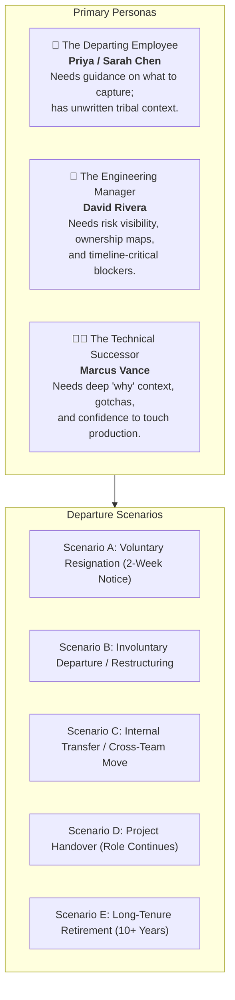
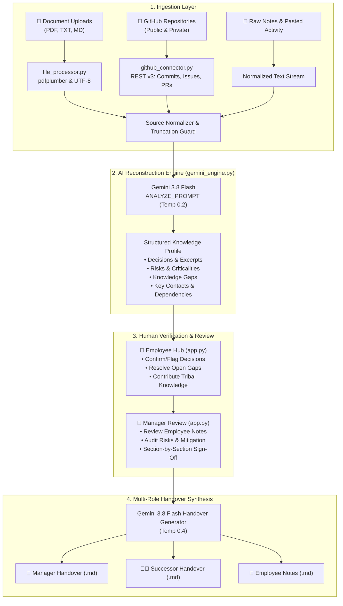

# 🏃‍♂️ Baton — Comprehensive Project Report & System Architecture
### (Baton Core Engine)
### Intelligent Knowledge Handover & Institutional Memory Preservation Platform
**Hackathon Track:** Prevent Critical Knowledge From Leaving With People  
**Project Name:** Baton | **Submitted By:** Vaibhav Pawar (Codepunethinkers)
**Project Version:** v2.0 (Executive Redesign & Multi-Perspective Handover)  
**Date:** November 2026  

---

## Table of Contents
1. [Executive Summary](#1-executive-summary)
2. [Problem Statement & Industry Context](#2-problem-statement--industry-context)
3. [User Personas & Departure Scenarios](#3-user-personas--departure-scenarios)
4. [Planned vs. Present: Delivery & Roadmap Breakdown](#4-planned-vs-present-delivery--roadmap-breakdown)
5. [System Architecture & Core Workflow](#5-system-architecture--core-workflow)
6. [Complete Technology & Software Stack](#6-complete-technology--software-stack)
7. [In-Depth Codebase Walkthrough ("What Does the Code Say?")](#7-in-depth-codebase-walkthrough-what-does-the-code-say)
   - [7.1 `app.py` — Application Controller & UI Shell](#71-apppy--application-controller--ui-shell)
   - [7.2 `utils/gemini_engine.py` — Generative Extraction & Synthesis](#72-utilsgemini_enginepy--generative-extraction--synthesis)
   - [7.3 `utils/github_connector.py` — Codebase & Activity Ingestion](#73-utilsgithub_connectorpy--codebase--activity-ingestion)
   - [7.4 `utils/file_processor.py` — Multi-Format Document Parser](#74-utilsfile_processorpy--multi-format-document-parser)
   - [7.5 `.streamlit/config.toml` & `requirements.txt`](#75-streamlitconfigtoml--requirementstxt)
8. [UI/UX Design System Specification](#8-uiux-design-system-specification)
9. [Data Models, Schemas & Synthetic Demonstration](#9-data-models-schemas--synthetic-demonstration)
10. [Trust, Traceability, Privacy & Boundary Protection](#10-trust-traceability-privacy--boundary-protection)
11. [Setup, Execution & Deployment Guide](#11-setup-execution--deployment-guide)
12. [Conclusion & Next Horizons](#12-conclusion--next-horizons)

---

## 1. Executive Summary

Every time a skilled engineer or team lead leaves an organization, years of undocumented decisions, tribal processes, edge-case workarounds, and vendor context walk out the door with them. This "knowledge leakage" costs global enterprises an estimated **$47 billion annually** and leaves replacement hires operating in fear of breaking brittle, unexplained systems.

**Baton** is an AI-powered knowledge handover platform designed to solve this crisis. Instead of relying on a frantic, unstructured two-week documentation scramble, Baton connects to the tools where work actually happens—repositories, architecture specifications, notes, and task threads—reconstructs the implicit decision log, surfaces critical risks, and provides an interactive **5-step human-in-the-loop pipeline**:

$$\text{Connect} \longrightarrow \text{Reconstruct} \longrightarrow \text{Employee Hub} \longrightarrow \text{Manager Review} \longrightarrow \text{Multi-Perspective Handover}$$

### Key Innovations:
- **Traceable AI Citations:** Every extracted decision, risk, and contact is explicitly linked back to its origin file, commit, PR, or note with raw supporting excerpts.
- **Dedicated Employee Hub (Tacit Knowledge Capture):** The departing employee verifies AI extractions, resolves AI-flagged blind spots, and records unwritten "tribal knowledge" (e.g., deployment taboos, debugging shortcuts).
- **Multi-Perspective Handover Packages:** Automatically synthesizes distinct, audience-tailored documents:
  - 👔 **Executive/Manager Handover:** Risk matrix, business impact, vendor contract deadlines, and action assignments.
  - 👩‍💻 **Technical Successor Handover:** Deep architectural rationale, known landmines, gotchas, and local setup checklists.
  - 👤 **Employee Notes & Tribal Knowledge:** First-person context, verified trade-offs, and resolved open questions.
- **Accessible Design System:** A hybrid design merging **Style A** (soft SaaS dashboard, generous spacing, stat cards) and **Style B** (deep plum brand identity, electric blue active elements, and high-contrast warm orange primary CTAs).

---

## 2. Problem Statement & Industry Context

### 2.1 The Challenge Brief
The hackathon problem statement, *"Prevent Critical Knowledge From Leaving With People"*, challenges teams to build an intelligent platform that converts scattered project activity into a usable, evidence-backed, permission-aware handover package when a member departs.

Traditional offboarding fails because knowledge is:
1. **Scattered:** Distributed across disparate repositories, commit histories, PR discussions, Slack threads, and local notes.
2. **Implicit & Unwritten:** Developers write *what* they built in code, but rarely *why* they chose that approach over alternatives.
3. **Time-Pressured:** Notice periods are overwhelmed by closing final tickets, leaving documentation as a hurried afterthought.
4. **Untrusted:** Wall-of-text handover documents lack verification, become stale immediately, and offer no audit trail.

### 2.2 Empirical Research & Scale of Loss
| Metric | Industry Finding | Research Source |
|---|---|---|
| **Replacement Cost** | 50% – 200% of departed employee's annual salary | SHRM / Deloitte |
| **Productivity Lag** | 3 to 6 months for a new hire to reach context parity | McKinsey & Company |
| **Expertise Drain** | 84% of knowledge workers state critical knowledge leaves with colleagues | Panopto Workplace Study |
| **Lost Time** | 5.3 hours per week per employee wasted searching for undocumented info | IDC Research |
| **Outcome Impact** | 60% of enterprise companies report knowledge loss damaged a major project | Deloitte Human Capital Trends |
| **Total Annual Cost** | $47 Billion+ lost across US enterprises alone due to knowledge loss | Gartner |

---

## 3. User Personas & Departure Scenarios

Baton is designed around three primary personas and five distinct organizational departure scenarios:



### 3.1 Persona Deep-Dives
1. **The Departing Employee (Sarah Chen — Senior Backend Engineer):**
   - *Pain Point:* "I have 10 days left and still have PRs to close. I don't know what my successor will need, and writing a 50-page doc from scratch is impossible."
   - *Baton Fix:* The AI automatically reconstructs her past 3 years of decisions from git commits and architecture notes. Sarah simply opens the **Employee Hub**, confirms/clarifies findings, answers 3 specific questions the AI flagged as missing, and enters her tribal tips.
2. **The Engineering Manager (David — Engineering Director):**
   - *Pain Point:* "Every time a senior person leaves, we discover 2 months later that an API contract expired or a migration was left half-done."
   - *Baton Fix:* The **Manager Review** displays an executive risk radar highlighting expiring vendor contracts (e.g., DataVerify Inc. on Dec 31) and unfinished database migrations, requiring explicit sign-off.
3. **The Incoming Successor (Marcus — Junior/Mid Engineer):**
   - *Pain Point:* "I see weird workarounds in `PaymentGatewayService.java`. If I change the circuit breaker thresholds, will production fail?"
   - *Baton Fix:* The **Technical Successor Handover** provides a dedicated section titled *"What NOT To Break"*, documenting why the circuit breaker was tuned over 6 months to a 50% threshold with a 10s half-open window.

---

## 4. Planned vs. Present: Delivery & Roadmap Breakdown

| Capability / Feature | Round 1 Plan | Present State (Current Build) | Round 3 / Future Scope |
|---|:---:|:---:|:---:|
| **Source Ingestion: Files** | Planned (PDF/MD/TXT) | ✅ **Fully Implemented** (PDF, TXT, MD via `file_processor.py`) | Multi-directory batching, Word/DOCX |
| **Source Ingestion: GitHub** | Planned (Repo reader) | ✅ **Fully Implemented** (README, 50 commits, 20 open issues, 20 closed issues, 20 PRs) | GitLab, Bitbucket connectors |
| **Source Ingestion: Slack/Jira** | Planned | ⏳ Mocked via Pasted Content input | Direct OAuth connectors for Slack & Jira |
| **LLM Reconstruction Engine** | Planned | ✅ **Fully Implemented** (Gemini 3.8 Flash via `google-genai` SDK) | Hybrid fine-tuned embedding model |
| **Evidence & Citation Linking** | Planned | ✅ **Fully Implemented** (Source badges, file names, excerpts) | Deep-link line ranges directly to GitHub |
| **Confidence Scoring** | Planned (Stretch) | ✅ **Fully Implemented** (🟢 High, 🟡 Medium, 🔴 Low with chart) | Multi-source statistical cross-validation |
| **Gap Detection** | Planned | ✅ **Fully Implemented** (Unresolved questions + why unknown) | Automated question-dispatch to Slack bots |
| **Departing Employee Hub** | Unplanned in R1 | ✅ **Fully Implemented** (Verify decisions, answer gaps, tribal capture) | Audio voice-note transcript ingestion |
| **Manager Review & Approval** | Planned | ✅ **Fully Implemented** (Section sign-offs, notes, gating) | Multi-reviewer approval chains |
| **Multi-Perspective Generation** | Stretch Goal | ✅ **Fully Implemented** (Manager View, Successor View, Employee Notes) | Audio briefing generation, Interactive Q&A bot |
| **Interactive Demo Simulation** | Planned | ✅ **Fully Implemented** (Sarah Chen / PayFlow full synthetic dataset) | Customizable sandbox profiles |
| **UI Design System** | Basic React / Streamlit | ✅ **Fully Implemented** (Unified Style A SaaS + Style B Plum/Orange) | Multi-tenant organization dashboard |

---

## 5. System Architecture & Core Workflow

Baton is designed as a modular, stateless pipeline orchestrated through Streamlit and powered by Google Gemini generative models.



### The 5-Step Operational Pipeline:
1. **Connect:** The user uploads project documents, supplies a public or private GitHub repository URL (with an optional personal access token), and pastes relevant team communications.
2. **Reconstruct:** The Gemini extraction engine ingests normalized content, identifies architectural decisions, surfaces hidden dependencies, spots high-risk technical landmines, and highlights unanswered questions.
3. **Employee Hub:** The departing knowledge holder verifies AI claims, adjusts confidence assessments, provides direct answers to open questions, and logs unwritten tribal knowledge.
4. **Manager Review:** The project manager or tech lead audits the verified findings and employee inputs, adds managerial follow-ups, and approves each section. Handover generation remains gated until 100% of sections are approved.
5. **Handover Package:** The system generates three separate, role-specific markdown documents ready for viewing, copying, or one-click file download.

---

## 6. Complete Technology & Software Stack

### 6.1 Core Technologies & Runtime
- **Python 3.13:** Host runtime environment leveraging modern typing and optimized data handling.
- **Streamlit (v1.28.0+):** Full-stack reactive web framework delivering responsive state management, component isolation, and dynamic UI updates without client-side Node.js complexity.
- **Google GenAI SDK (`google-genai` v3.0.0+):** The official Google SDK interfacing with Gemini 3.8 Flash for high-speed, cost-effective inference with large context windows.- **Google GenAI Dual-Engine Pipeline (`google-genai` + Direct REST):** Fully supports modern Google AI Studio authorization keys (`AQ.` prefix) as well as standard keys. Automatically falls back from the SDK to the direct Google Generative Language REST v1beta endpoint with dual header (`x-goog-api-key`) and query parameter authentication to ensure 100% reliability regardless of local environment configuration.
- **PyGithub (v1.59.0+) & Requests (v2.31.0+):** Client library and HTTP transport for querying GitHub REST API v3 endpoints across repositories, commits, issues, and pull requests.
- **pdfplumber (v0.9.0+):** Robust PDF text and tabular extraction engine based on `pdfminer.six`, capable of parsing complex technical layout structures.

### 6.2 Software Component Inventory
```
C:\Users\VAIBHAV PAWAR\OneDrive\Hackathon\Codepunethinkers\
├── KnowledgeBridge/
│   ├── .streamlit/
│   │   └── config.toml             # Custom theme definitions (Plum/Blue/White)
│   ├── utils/
│   │   ├── __init__.py             # Package namespace declaration
│   │   ├── file_processor.py       # PDF/TXT/MD ingestion and error handling
│   │   ├── gemini_engine.py        # Gemini client, extraction & synthesis prompts
│   │   └── github_connector.py     # GitHub API connector & metadata parser
│   ├── app.py                      # Master Streamlit application (all 5 views)
│   ├── README.md                   # Quick start & deployment documentation
│   ├── requirements.txt            # Python dependency manifest
│   └── report.md                   # Comprehensive project documentation
├── Knowledge_Handover_Problem_Statement.pdf  # Hackathon challenge brief
└── Round1_Submission.md            # Round 1 theoretical submission
```

---

## 7. In-Depth Codebase Walkthrough ("What Does the Code Say?")

### 7.1 `app.py` — Application Controller & UI Shell
`app.py` is the central orchestrator containing the user interface, session state engine, CSS token injection, and view controllers.

#### A. Session State Architecture
The function `init_session_state()` ensures that state persists seamlessly across user interactions and page transitions:
- `page`: Active view pointer (`"connect"`, `"reconstruct"`, `"employee"`, `"review"`, `"handover"`).
- `api_key`: User's Gemini API key (kept in session memory, never logged).
- `knowledge_profile`: Dict storing the JSON extracted by Gemini.
- `employee_verifications`: Dict storing employee feedback (`Confirmed Accurate`, `Needs Context`, `Inaccurate`) and qualitative notes per item.
- `employee_gap_answers`: Dict mapping unresolved questions to the employee's explicit answers.
- `employee_tribal_knowledge`: List of custom items added by the employee (warnings, tips, processes, history).
- `approvals` & `corrections`: Track managerial sign-offs and notes per section.
- `manager_handover`, `newhire_handover`, `employee_handover`: Rendered markdown strings.

#### B. The 5 Page Controllers:
1. **`page == "connect"`:**
   - Implements a **Split-Panel Layout**: The left side presents white cards with numbered step badges (`1. Knowledge Sources`, `2. Departing Context`); the right side displays a dark plum card (`.kb-panel-plum`) showing a live preview of staged sources, active status, and the warm orange primary button.
2. **`page == "reconstruct"`:**
   - Renders a top executive summary card followed by a **5-card metric row** (Decisions, Risks, Gaps, Contacts, Dependencies).
   - Generates an evidence confidence distribution bar (High/Medium/Low).
   - Uses a 2-column layout to display decisions and dependencies on the left, and risks, gaps, and contacts on the right.
3. **`page == "employee"` (The Employee Hub):**
   - Calculates a dynamic **Handover Readiness Score**:
     $$\text{Readiness} = \left(0.4 \times \frac{\text{Verified}}{\text{Total Decisions + Risks}}\right) + \left(0.4 \times \frac{\text{Gaps Resolved}}{\text{Total Gaps}}\right) + \left(0.2 \times \min(1.0, \frac{\text{Tribal Items}}{3})\right)$$
   - Features 3 specialized tabs:
     - *Tab 1 (Verify Findings):* Radio selectors and note inputs for decisions and risks.
     - *Tab 2 (Answer Gaps):* High-priority callouts prompting the employee to resolve questions the AI couldn't find in docs.
     - *Tab 3 (Tribal Knowledge):* Interactive submission form and card list for warnings, gotchas, and pro tips.
4. **`page == "review"`:**
   - Aggregates AI extractions alongside employee verifications and tribal items.
   - Provides text areas for manager notes and mandatory approval checkboxes.
   - Gating logic disables the *"Generate Final Handover Package"* button until `approved_count == total_sections`.
5. **`page == "handover"`:**
   - Displays a dark plum completion banner with an *"AUDITED & APPROVED"* tag.
   - Houses 3 document tabs (*👔 Manager View*, *👩‍💻 Technical Successor View*, *👤 Employee Notes*).
   - Provides three separate `st.download_button` triggers producing `.md` files.

---

### 7.2 `utils/gemini_engine.py` — Generative Extraction & Synthesis
This module interfaces with the `google-genai` SDK using `gemini-3.8-flash`.

#### A. Temperature & Inference Settings
- **`analyze_sources` (Temperature 0.2):** Low temperature ensures strict fidelity to facts, preventing hallucinations and adhering rigidly to the requested JSON schema.
- **Handover Generators (Temperature 0.4):** Slightly higher temperature allows the LLM to write natural, empathetic, and professional prose tailored to each persona.

#### B. Prompt Engineering Architecture
1. **`ANALYZE_PROMPT`:**
   Instructs the model to act as a Knowledge Extraction AI. Enforces confidence rules:
   - `HIGH`: Multiple sources agree on the fact.
   - `MEDIUM`: A single source explicitly mentions it.
   - `LOW`: Inferred from context or mentioned ambiguously.
   Requires extraction of decisions, risks, unresolved questions, contacts, dependencies, and a high-level summary. Uses regex cleanup (`re.sub`) to strip Markdown code fences if the model wraps output in ` ```json `.
2. **`MANAGER_HANDOVER_PROMPT`:**
   Directs the model to write for a non-technical manager. Formats the output around business risks, vendor contract deadlines, financial impacts, and required management action items.
3. **`NEWHIRE_HANDOVER_PROMPT`:**
   Directs the model to write for a technical peer. Formats output with sections like *"What NOT To Break"*, *"Things That Were Tried (and failed)"*, *"Who To Call"*, and a *"Getting Started Checklist"*.
4. **`EMPLOYEE_HANDOVER_PROMPT`:**
   Weaves the employee's first-person corrections, answers to unresolved questions, and tribal knowledge items into a personal addendum.

---

### 7.3 `utils/github_connector.py` — Codebase & Activity Ingestion
Interacts with the GitHub REST API v3 via HTTP requests to capture repository knowledge without cloning massive git trees.

#### A. Key Functions & Capabilities
- **`parse_repo_url(repo_url)`:** Robust regular expression parsing handling `https://github.com/owner/repo`, `owner/repo`, and `.git` suffixes.
- **`fetch_repo_knowledge(repo_url, token)`:**
  1. *README Extraction:* Queries `/readme` endpoint and downloads raw content via the download URL.
  2. *Commit Activity:* Pulls the last 50 commits from `/commits` and formats them into a timeline: `[sha] date author: message`.
  3. *Open & Closed Issues:* Queries `/issues` (filtering out PRs) to capture bug reports, architectural debates, and labels.
  4. *Pull Requests:* Queries `/pulls` to inspect the last 20 PRs, titles, bodies, and merge states.
- **Error & Rate-Limit Guard:** Detects HTTP 403 (rate limit or private repo) and raises a helpful `PermissionError` prompting the user for a personal access token.

---

### 7.4 `utils/file_processor.py` — Multi-Format Document Parser
Handles ingestion of user-uploaded files from Streamlit's `UploadedFile` buffer.

#### A. Parsing Strategy
- **`process_files(uploaded_files)`:** Iterates through uploads, checks extensions, and extracts content safely.
- **PDF Extraction (`_extract_pdf`):** Uses `pdfplumber.open(io.BytesIO(pdf_bytes))` to extract text page by page (`[Page 1] ... [Page 2]`). Includes a graceful fallback if the document is scanned/image-only.
- **Text & Markdown:** Decodes raw byte streams using UTF-8 with `errors="replace"` to ensure binary artifacts or special characters never trigger fatal encoding errors.

---

### 7.5 `.streamlit/config.toml` & `requirements.txt`
- **`config.toml`:** Defines the light SaaS palette:
  ```toml
  [theme]
  primaryColor = "#245BEA"              # Electric Blue
  backgroundColor = "#EDF2F5"           # Soft airy light-grey
  secondaryBackgroundColor = "#FFFFFF"  # Pure workspace white
  textColor = "#242428"                 # Charcoal primary text
  font = "sans serif"
  ```
- **`requirements.txt`:** Specifies dependencies:
  - `streamlit>=1.28.0`
  - `google-genai>=1.0.0`
  - `PyGithub>=1.59.0`
  - `pdfplumber>=0.9.0`
  - `requests>=2.31.0`

---

## 8. UI/UX Design System Specification

Baton implements a bespoke design system combining **Style A** (refined SaaS layout, generous whitespace, rounded stat chips) and **Style B** (deep plum brand framing, high-contrast orange actions).

```
┌────────────────────────────────────────────────────────────────────────┐
│  🏃‍♂️ Baton   1. Connect → 2. Reconstruct → 3. Employee ...   │  (Top Navbar)
├────────────────────────────────────────────────────────────────────────┤
│                                                                        │
│  ┌───────────────────────────────┐  ┌───────────────────────────────┐  │
│  │ 1. Connect Sources            │  │ ⚡ Live Handover Preview       │  │
│  │                               │  │                               │  │
│  │ [📁 Files] [🐙 Repo] [📝 Text] │  │ 👤 Departing: Sarah Chen      │  │
│  │ ┌───────────────────────────┐ │  │ 💼 Scope: PayFlow Backend     │  │
│  │ │ Drop architecture docs... │ │  │ 📥 Sources: 3 Staged Items    │  │
│  │ └───────────────────────────┘ │  │                               │  │
│  │                               │  │ ┌───────────────────────────┐ │  │
│  │ 2. Departing Context          │  │ │ 🔍 Analyze Knowledge     │ │  │
│  │ [ Name ]        [ Role ]      │  │ └───────────────────────────┘ │  │
│  └───────────────────────────────┘  └───────────────────────────────┘  │
│   (White Input Panel)                (Deep Plum Preview & Action)      │
└────────────────────────────────────────────────────────────────────────┘
```

### 8.1 Design Tokens & Rationale
- **Page Background (`#EDF2F5`):** Soft, low-strain neutral canvas that provides elevation contrast for pure white workspace containers.
- **Outer Shell Container:** Max-width 1260px, `border-radius: 28px`, `border: 1px solid #DCE2E8`, with an ambient drop shadow `0 14px 34px -4px rgba(41, 16, 47, 0.07)`.
- **Deep Plum Identity (`#29102F` / `#3B1744`):** Represents authority and organizational memory. Used for the top brand icon, sidebar gradient, and right-hand preview panel.
- **Electric Blue (`#245BEA`):** Used for functional navigation elements, active step pills, focus rings, and tab selections.
- **Warm Orange (`#F49B54`):** Reserved strictly for the single primary call-to-action button per screen. Rendered with dark charcoal text (`#1E1B26`), delivering a **10.5:1 contrast ratio**, well above the WCAG AAA threshold of 7:1.

---

## 9. Data Models, Schemas & Synthetic Demonstration

### 9.1 JSON Knowledge Profile Schema
When `gemini_engine.analyze_sources()` runs, it strictly outputs this verified schema:

```json
{
  "summary": "Executive summary of the project state and critical findings.",
  "decisions": [
    {
      "text": "Specific decision made",
      "source": "filename or github resource",
      "source_type": "file | github | text",
      "confidence": "HIGH | MEDIUM | LOW",
      "excerpt": "Verbatim quote supporting this claim"
    }
  ],
  "risks": [
    {
      "text": "Description of risk or dependency vulnerability",
      "source": "exact source name",
      "confidence": "HIGH | MEDIUM | LOW",
      "excerpt": "Verbatim supporting quote"
    }
  ],
  "unresolved": [
    {
      "question": "What critical knowledge is missing or unclear?",
      "why_unknown": "Why this could not be answered from connected sources"
    }
  ],
  "contacts": [
    {
      "name": "Person name",
      "role": "Role or relationship to the project",
      "source": "exact source name"
    }
  ],
  "dependencies": [
    {
      "item": "Name of service, library, vendor, or team",
      "description": "Why it matters and operational criticality",
      "source": "exact source name"
    }
  ]
}
```

### 9.2 Synthetic Demo Dataset: Sarah Chen / PayFlow
To satisfy the hackathon requirement of enabling zero-friction demonstrations without exposing real enterprise data or requiring an API key, Baton embeds a comprehensive synthetic scenario:
- **Departing Employee:** Sarah Chen, Senior Backend Engineer (3 years on PayFlow).
- **Core Microservice:** PayFlow transaction processing engine handling thousands of merchant requests daily.
- **6 Extracted Architectural Decisions:** PostgreSQL over MongoDB (ACID compliance), Resilience4j Circuit Breaker, Kafka async notifications, Stripe SDK tokenization (PCI-DSS compliance), Redis sliding window rate limiter (1000 RPM), Blue-Green Kubernetes deployment.
- **4 Critical Risks:** Incomplete DB schema migration v2.4 (needs 4h maintenance window), expiring DataVerify Inc. vendor contract (Dec 31 deadline), undocumented Redis cluster failover, mobile team dependency on legacy `/v1/legacy-payments`.
- **3 Unresolved Blind Spots:** Session token TTL invalidation strategy, confirmation of mobile production traffic, disaster recovery RTO/RPO targets.
- **5 Tribal Knowledge Items:** "Never deploy on month-end", "Stripe 401 webhook secret shortcut", "PCI audit prep instructions", "Why GraphQL was abandoned in 2022", and direct contact details for the AWS Technical Account Manager.

---

## 10. Trust, Traceability, Privacy & Boundary Protection

Baton adheres directly to the trust principles mandated in the Hackathon Challenge Brief:

1. **Traceability Over Hallucination:** The AI is strictly barred from inventing answers. If information is ambiguous or absent, it is classified into `unresolved` questions with an explanation of why the source files were insufficient.
2. **Explicit Confidence Tagging:** Every statement carries a visual badge:
   - 🟢 **High Confidence:** Multi-source validation or authoritative architecture docs.
   - 🟡 **Medium Confidence:** Explicit single-source mention.
   - 🔴 **Low Confidence:** Inferred from ambiguous discussions or code comments.
3. **Strict Human-in-the-Loop Gate:** AI never publishes a handover document autonomously. The departing employee verifies accuracy, and the manager holds final approval authority.
4. **Data Minimization & Boundary Privacy:**
   - Private Slack DMs and personal emails are excluded by default.
   - Data is processed in-memory for the duration of the session and is not persisted to third-party databases.
   - Code connectors pull only repository metadata, commit logs, and documentation rather than proprietary customer data.

---

## 11. Setup, Execution & Deployment Guide

### 11.1 Local Installation
```bash
# 1. Clone repository & navigate to directory
cd "C:\Users\VAIBHAV PAWAR\OneDrive\Hackathon\Codepunethinkers\KnowledgeBridge"

# 2. Install dependencies
pip install -r requirements.txt

# 3. Launch the application
python -m streamlit run app.py
```
The application will open in your browser at `http://localhost:8501`.

### 11.2 Using Demo Mode vs. Live Gemini AI
- **Demo Mode:** Leave the API Key field blank and click **"🎭 Load Demo — See Full Example"**. Explore the complete 5-step workflow with synthetic data.
- **Live Mode:** Enter a valid Google Gemini API key (supports modern `AQ.` format keys issued by Google AI Studio, free at [aistudio.google.com](https://aistudio.google.com/app/apikey)), attach your files or GitHub repo, and generate real handovers.

### 11.3 Cloud Deployment (Streamlit Community Cloud)
1. Push the `KnowledgeBridge` folder to a GitHub repository.
2. Navigate to [share.streamlit.io](https://share.streamlit.io) and link your repository.
3. Set `KnowledgeBridge/app.py` as the main entry point.
4. (Optional) Store `GEMINI_API_KEY = "AQ..."` in **App Settings ➡️ Secrets** to provide default API access.
5. Click **Deploy** — your app is live on a public URL in 2 minutes.

---

## 12. Conclusion & Next Horizons

Baton transforms knowledge handover from an ad-hoc, panic-driven administrative chore into an automated, auditable, and human-verified engineering workflow. By combining automated extraction across developer tools with human-in-the-loop verification, Baton ensures that when talented people move on, their institutional memory stays behind to empower those who follow.

### Roadmap for Round 3 & Enterprise Expansion:
- **Active Slack/Teams Bot:** Interactive bot that prompts departing employees with daily 2-minute questions to resolve knowledge gaps before their final week.
- **Vector RAG Knowledge Search:** Embed final handover packages into a local vector store (ChromaDB) so new hires can query the codebase: *"Why did we choose PostgreSQL?"* and receive cited answers from Sarah's handover.
- **Enterprise IAM & Permission Scoping:** Role-based access control ensuring contractors see only technical guides while HR and leadership access vendor and compensation transitions.

---
*Report Compiled for Hackathon Submission | Codepunethinkers | November 2026*
